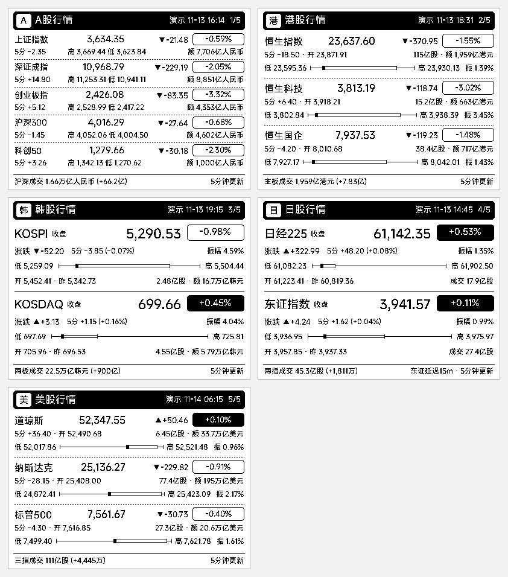

# 极趣墨水屏 五页全球行情数据面板（A / 港 / 韩 / 日 / 美）

适配极趣墨水屏 (Zectrix) **400×300 1-bit** 五页看板，默认全屏展示 **A、港、韩、日、美** 五大市场实时行情数据面板，**含日内涨跌与 5 分钟变化**，**每 5 分钟自动更新（每轮都是先抓取再推送）**。

五页渲染效果（`python3 market_board.py --demo-delta --dry-run --contact-sheet images/market_preview.png`）：



---

## 📊 五页数据面板（`mode=market`，默认）

| 页 | 市场 | 覆盖指数 | 展示数据与变化 | 金额/量纲口径（原币直出，不换算） |
|---|---|---|---|---|
| **1** | **A**（A股） | 上证指数、深证成指、创业板指、沪深300、科创50 | 最新点位、▲/▼涨跌额、涨跌幅徽章、`5分` 点位变化、日内高/低、成交额；底栏沪深两市总成交额及 `5分` 增量 | `人民币` |
| **2** | **港**（港股） | 恒生指数、恒生科技、恒生国企 | 最新点位、▲/▼涨跌额、涨跌幅徽章、`5分` 点位变化、今开、日内低—高区间条、振幅、成交股数、成交额；底栏主板成交额及 `5分` 增量 | `港元` / `股` |
| **3** | **韩**（韩股） | KOSPI、KOSDAQ | 最新点位、交易状态、涨跌幅徽章、▲/▼涨跌额、`5分` 点位与百分比变化、振幅、日内低—高区间条、今开/昨收、成交股数、成交额；底栏两板总成交额及 `5分` 增量 | `韩元` / `股` |
| **4** | **日**（日股） | 日经225、东证指数 | 最新点位、交易状态、涨跌幅徽章、▲/▼涨跌额、`5分` 点位与百分比变化、振幅、日内低—高区间条、今开/昨收、成交股数；底栏两指成交股数及 `5分` 增量（东证交易所延迟约 15 分钟，日经盘中实时叠加） | `日元`（点位）/ `股` |
| **5** | **美**（美股） | 道琼斯、纳斯达克、标普500 | 最新点位、▲/▼涨跌额、涨跌幅徽章、`5分` 点位变化、今开/昨收、日内低—高区间条、振幅、成交股数；底栏三指成交股数及 `5分` 增量 | `美元`（点位）/ `股` |

- **数据源（公开免密钥，7 路并发互备）**：
  1. 腾讯证券 `qt.gtimg.cn`（A / `r_hk*` 港股实时 / 美股 / 日韩实时点位）
  2. 新浪财经 `hq.sinajs.cn`（港股成交股数 + A/港/美独立热备，需 Referer）
  3. Naver 金融 `domestic/index`（KOSPI/KOSDAQ 实时全字段）
  4. Naver 金融 `worldstock/index`（日经225/东证全字段，东京延迟约 15 分钟）
  5. 新浪国际指数 `int_*`（港 / 日 / 韩 / 美指数备用源，仅点位与涨跌）
  6. 网易财经 `api.money.126.net`（A 股 5 大指数备用源，含成交额与成交量）
  7. 东方财富 `push2.eastmoney.com`（A / 港 / 美指数备用源，含成交额与成交量）

  聚合时按指数做**多源一致性投票**（`_merge_candidates`）：偏差在容差内（A/美 1%、港/韩 1.5%、日经 3%）视为同一笔行情，备用源只补缺失字段；偏差超容差时仅当备用源行情时间严格更新才改信它，防止延迟源或口径异常的源把好数据带偏。
- **变化计算（`apply_delta_state`）**：同时展示**较昨收涨跌额/涨跌幅**（涨为黑底反白徽章 + `▲`，跌为白底描边徽章 + `▼`）与**较上一轮抓取的点位/成交变化**（默认 `5分 ±X.XX`，标签随 `--interval` 自动变成 `1分` / `15分`）；休市重复采样保持最后一跳变化不洗零，跨交易日自动重置基线。
- **墨水屏防闪屏 & 容错**：每页独立计算 1-bit 像素 SHA-256，**仅推送画面发生变化的页**（例如夜间美股开盘时只刷新第 5 页，1–4 页休市零刷屏）；单页临时无有效行情时跳过推送，保留屏上原内容；推送失败页下一轮自动补推。

---

## ⏱️ 五分钟自动更新（GitHub Actions 常驻接力 + 看门狗）

只需在仓库 `Settings → Secrets and variables → Actions` 配置两个密钥（行情接口全部免密钥）：

| Secret | 说明 |
|---|---|
| `ZECTRIX_API_KEY` | 极趣云 API Key（https://cloud.zectrix.com） |
| `ZECTRIX_MAC` | 墨水屏 MAC 地址（如 `AA:BB:CC:DD:EE:FF`） |

工作流 `.github/workflows/run.yml`（与根目录 `w.yml` 逐字同步）+ `.github/workflows/market-watchdog.yml`：

1. **每 5 分钟一轮（每轮先抓后推）**：`market_loop.py` 按单调时钟对齐 300 秒槽位循环调用 `market_board.py`，**抓取只发生在每一轮推送之前**——抓行情 → 算变化 → 渲染 → 推屏，两轮之间纯等待，不空转刷接口；不向仓库产生任何机器人 commit（变化基线与页面指纹存于 `.octopus/market_state.json`，跨轮通过 Actions Cache 传递）。
2. **无缝自动接力**：单轮运行 330 分钟（5.5 小时）；正常跑满 5 分钟且至少成功采样 1 轮后自动预约下一轮排队，本轮结束立即接棒。
3. **自动让位**：推送新代码或人工点击 `Run workflow` 时，当前运行在下一轮（≤5 分钟）自动收尾让位。
4. **看门狗兜底**：`market-watchdog.yml` 每小时 17、47 分检查一次，仅当没有任何运行中/排队中的 `run.yml` 时重新拉起 `mode=market`。
5. **如何暂停**：在 Actions 页面同时 Disable「章鱼 AI·全景分析 看板」与「行情面板看门狗」，再取消当前运行中与排队中的任务。

---

## 💻 本地运行与预览

```bash
pip install requests pillow

# 离线演示五页（含 5 分钟变化，不联网、不推送）
python3 market_board.py --demo-delta --dry-run --contact-sheet images/market_preview.png

# 真实联网单轮预览（不推墨水屏）
python3 main.py --dry-run

# 真实推送到 Zectrix 墨水屏
export ZECTRIX_API_KEY=你的Key
export ZECTRIX_MAC=AA:BB:CC:DD:EE:FF
python3 main.py                        # 单轮推送五页（1=A,2=港,3=韩,4=日,5=美）
python3 main.py --loop --interval 300  # 本地常驻每 5 分钟自动更新推屏（默认值）
python3 market_board.py --pages 1,2,5  # 仅更新指定市场页
python3 market_board.py --force        # 忽略像素指纹强制重推五页
python3 market_board.py --interval 60  # 把「5分」文案改成「1分」（只改文案，不改循环）
```

### 兼容保留的历史模式

手动运行或 Actions `Run workflow` 仍可随时切换：

```bash
python3 main.py --mode brief --dry-run                                 # 004/003/007 五页简报
python3 main.py --mode octopus --dry-run                               # 仓库 02 打氧日报五页
python3 main.py --from-file tests/fixtures/latest_sample.html --dry-run # 打氧日报离线预览
python3 main.py --mode news --pages 1,2,3,4 --dry-run                  # 财新 + 东方财富新闻看板
```

---

## 🧪 离线回归测试

```bash
python3 -m unittest discover -s tests -v
```

覆盖：五页顺序与原生币种约束、腾讯/新浪/Naver/新浪国际/网易/东方财富 七路解析与时区换算（含美东夏令时/冬令时）、多源合并与单源断流兜底、日经盘中叠加与异常偏离保护、5 分钟变化幂等与跨日重置、五页 400×300 1-bit 排版越界校验（含极端大数与缺项）、按页像素指纹去重与失败自动补推、300 秒常驻循环接力/让位/看门狗配置与多源一致性投票，以及原有 `brief` / `octopus` 全部回归用例。

---

## 🗂 代码结构

| 文件 | 作用 |
|---|---|
| `market_quotes.py` | 五大市场（A/港/韩/日/美）七路并发抓取、纯函数解析、多源一致性投票合并、5 分钟变化状态演进与单位格式化 |
| `market_board.py` | 400×300 1-bit 五页行情面板渲染器、版面越界预检、按页 SHA-256 指纹去重与 Zectrix 推送 |
| `market_loop.py` | 300 秒（5 分钟）常驻更新循环、GitHub Actions 5.5 小时自动接力、新运行自动让位与运行摘要 |
| `.github/workflows/run.yml` / `w.yml` | 主工作流（默认 `mode=market` 每 5 分钟更新，保留 `brief`/`octopus`/`news`/`both`） |
| `.github/workflows/market-watchdog.yml` | 每半小时巡检看门狗，接力链意外中断时自动重拉 |
| `board_core.py` | 共用底层：画布尺寸、字体加载、单位规范化、Zectrix 云端推送通道 |
| `main.py` | 统一命令行入口（默认 `--mode market`，支持 `--loop` 常驻） |
| `brief_board.py` / `octopus_board.py` / `octopus_report.py` | 保留兼容的简报与打氧日报模式 |
| `tests/` | 全部离线单元测试与行情/日报 fixtures |
